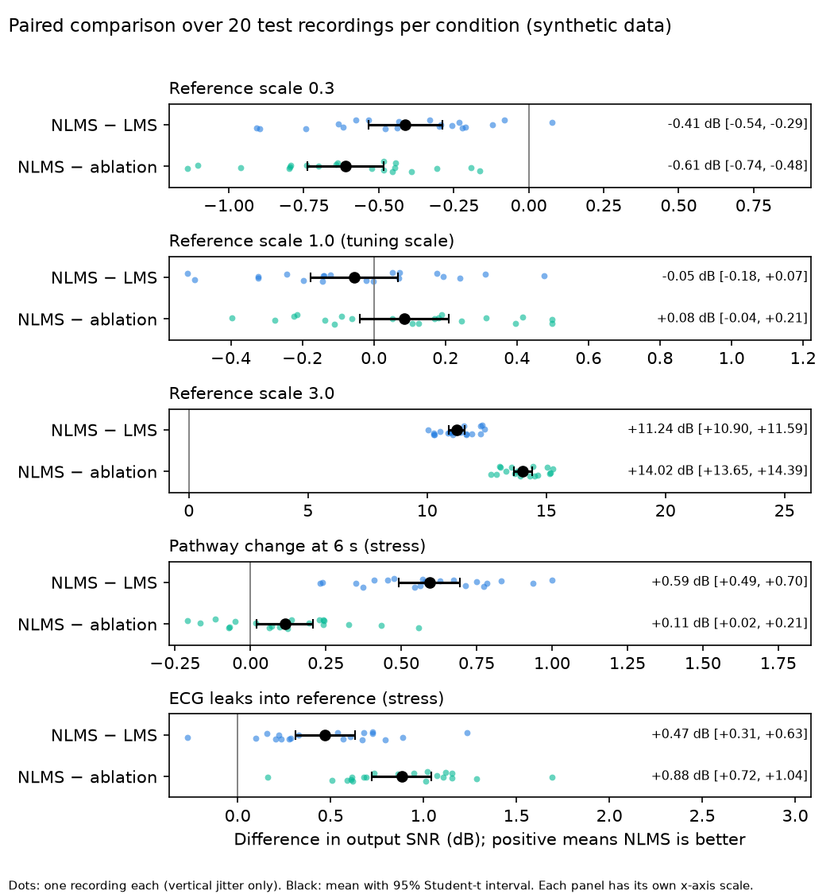

# Adaptive ECG Noise Cancellation: LMS vs. Normalised LMS

EEP55C36 Computational Methods — Final Project, Track B (Biomedical).

This project reproduces the reference-noise cancellation method from:

> N. V. Thakor and Y.-S. Zhu, "Applications of Adaptive Filtering to ECG Analysis: Noise
> Cancellation and Arrhythmia Detection," IEEE Transactions on Biomedical Engineering,
> 38(8), 785–794, 1991. https://doi.org/10.1109/10.83591

A least-mean-squares (LMS) adaptive filter uses a reference measurement of the interference to
estimate and subtract power-line noise from a measured ECG-like signal. Only the noise-cancellation
part of the paper is reproduced; arrhythmia detection is out of scope.

The modification normalises the LMS step size by the energy of the reference input vector
(normalised LMS, NLMS). This is a known method, implemented independently here, not a new
discovery. The two methods are compared on the same inputs using reproducible experiments.

All data are synthetic; no clinical claims are made.
## Method

**Signal model** (course guide). At sample $n$, the measured signal is
$d_n = s_n + v_n + \text{noise}$, where $s$ is the clean ECG and the interference $v$ is the
reference $r$ passed through an unknown 3-tap pathway. The filters see only $d$ and $r$; the clean
ECG is used only for scoring.

**Filter.** With $\mathbf{x}_n = [r_n, r_{n-1}, \dots, r_{n-M+1}]^T$ (zeros before the start) and
weights $\mathbf{w}_0 = \mathbf{0}$, each sample computes the interference estimate
$y_n = \mathbf{w}_n^T \mathbf{x}_n$ and the output $e_n = d_n - y_n$, which is the ECG estimate.
Only the weight update differs:

| Method | Update | File |
|---|---|---|
| Baseline LMS | $\mathbf{w} \leftarrow \mathbf{w} + \mu\, e_n \mathbf{x}_n$ | [`src/baseline.py`](src/baseline.py) |
| Modified NLMS | $\mathbf{w} \leftarrow \mathbf{w} + \dfrac{\mu}{\epsilon + \mathbf{x}_n^T \mathbf{x}_n}\, e_n \mathbf{x}_n$ | [`src/modified.py`](src/modified.py) |
| Ablation | $\mathbf{w} \leftarrow \mathbf{w} + \dfrac{\mu}{\epsilon + E}\, e_n \mathbf{x}_n$, fixed $E$ | `nlms_filter(..., normalize=False, reference_energy=E)` |

The update follows the course guide's half-squared-error convention; papers that use the full
squared error write $2\mu$, and the factor of two is absorbed into $\mu$.

**Why the change may help.** The usable LMS step size depends on the reference power (roughly
$\mu < 2 / (M P_r)$), so a step tuned at one reference amplitude adapts slowly at a smaller one and
fluctuates or diverges at a larger one. NLMS divides by the input energy; with $\epsilon = 0$ its
output is exactly unchanged when the reference is scaled (tested in
[`tests/test_modified.py`](tests/test_modified.py)).

**Predictions, recorded before the final test** ([`docs/progress.md`](docs/progress.md)): NLMS should
help when the reference amplitude differs from the tuning amplitude; it may hurt with a very weak
reference; at the tuning amplitude LMS may be as good.

**Key assumption.** The reference must not contain the ECG. If it does (leakage), the filter also
removes part of the ECG; this is tested as a failure case.

**Cost.** Both filters need $O(M)$ operations and storage per sample. NLMS adds one length-$M$ dot
product and one division per sample.

## Repository layout

| Path | Contents |
|---|---|
| [`src/data.py`](src/data.py) | Synthetic ECG, reference and interference generator (course guide), with stress options |
| [`src/baseline.py`](src/baseline.py) | Baseline LMS canceller |
| [`src/modified.py`](src/modified.py) | Modified NLMS canceller, with an ablation switch |
| [`src/metrics.py`](src/metrics.py) | MSE, SNR, R-peak error, paired differences with 95% intervals |
| [`src/experiment.py`](src/experiment.py) | Running methods, validation-only parameter selection, evaluation, timing |
| [`run_experiments.py`](run_experiments.py) | Runs the whole comparison from a configuration file and saves the results |
| [`make_figures.py`](make_figures.py) | Draws the figures from a saved results folder |
| [`configs/`](configs/) | Experiment settings: `smoke.json` (quick check) and `final.json` (full experiment) |
| [`tests/`](tests/) | Local checks for every module |
| [`results/final/`](results/final/) | Submitted results: CSV/JSON tables and `figures/` |
| [`docs/`](docs/) | Progress log, AI usage log and project conventions |

## Tested environment

| | |
|---|---|
| Machine | MacBook Air, Apple M5 (arm64) |
| Operating system | macOS 27.0.1 |
| Environment | conda, Python 3.12.16 |
| Packages | numpy 2.5.5, scipy 1.18.1, matplotlib 3.11.2, pytest 9.2.0 (pinned in [`requirements.txt`](requirements.txt)) |

## Installation

```bash
git clone https://github.com/JeffreyZhou-CN/MiniProject_ECG.git
cd MiniProject_ECG
conda env create -f environment.yml
conda activate ecg-anc
```

[`environment.yml`](environment.yml) installs Python 3.12 from conda-forge and the pinned packages from
`requirements.txt` with pip. 

All commands below are run from the repository root with the environment activated.

## Smoke run

```bash
python run_experiments.py --config configs/smoke.json
python make_figures.py --results results/smoke
```

A small grid with 3 validation and 3 test recordings; it checks the installation and shows all three
methods, but it is **not** the scientific evaluation. It takes a few seconds. The console prints the
selected parameters, the NLMS − LMS difference in output SNR for each condition and the runtimes.
Outputs are written to `results/smoke/`.

## Running the checks

```bash
python -m pytest
```

Expected: `73 passed` in under a minute. The tests cover hand-computed examples, edge cases and
properties of every module (for example: the LMS example from the course guide, scale invariance of
NLMS, convergence to the true interference pathway, and the disjoint seed splits).

## Reproducing the final results

```bash
python run_experiments.py --config configs/final.json
python make_figures.py --results results/final
```

The first command takes about 5 seconds and the second about 10 seconds on the tested machine. They
write to `results/final/` (folders are created automatically):

| File | Contents |
|---|---|
| `selected_params.json` | Parameters chosen on validation data, and the ablation's fixed energy |
| `validation_grid.csv` | Mean validation SNR for every grid point of both methods |
| `cases.csv` | One row per condition × test recording × method, with all metrics |
| `summary.csv` | Mean metrics per condition and method, with divergence counts |
| `paired.csv` | Paired differences (NLMS − LMS, NLMS − ablation) with 95% intervals |
| `timing.csv` | Median runtime per recording after a warm-up, with quartiles |
| `environment.json`, `config_used.json` | Machine and package versions; the exact settings used |
| `figures/fig1_example.png` … `fig4_failure_cases.png` | The four figures |

All metrics are deterministic: the same configuration gives the same values on any machine up to
floating-point rounding. Runtimes depend on the machine, so re-running overwrites `timing.csv` with
slightly different times; the submitted values are those in this repository.


## Experimental protocol

All settings are in [`configs/final.json`](configs/final.json), fixed before the final test was run.

**Data.** Each seed gives one independent 12 s recording at 250 Hz (3000 samples) from the course
guide's generator. Recordings are split as whole recordings; the code checks that the splits are
disjoint.

| Split | Seeds | Use |
|---|---|---|
| Development | 0–19 | Writing and debugging code, unit tests |
| Validation | 100–109 | Selecting parameters only (reference scale 1.0) |
| Test | 1000–1019 | Final comparison only: 20 paired recordings per condition |

**"Training" and tuning.** Both filters adapt online; weights are reset to zero for every recording.
Parameters are chosen by grid search on the validation recordings, maximising the mean output SNR
after the warm-up. Both methods get the same budget: $M \in \{2, 3, 4, 8, 16\}$ and 8 step sizes each
(LMS $\mu$ from 0.001 to 0.2, NLMS $\mu$ from 0.01 to 1.5, since NLMS steps are dimensionless).
$\epsilon = 10^{-6}$ is fixed, not tuned. The ablation reuses the NLMS $(M, \mu)$ with $E$ equal to the
mean input energy on the validation recordings, and gets no extra tuning. Clean test signals are
never used for any choice.

**Test conditions.** Parameters are tuned at reference scale 1.0 and then frozen, so the other
scales test an amplitude not seen during tuning.

| Condition | Setting | Purpose |
|---|---|---|
| `scale_0.3`, `scale_1.0`, `scale_3.0` | Reference (and interference) amplitude | Three difficulty settings |
| `pathway_change` | At 6 s the pathway changes from [0.35, −0.15, 0.08] to [−0.2, 0.3, 0.1] | Stress: re-adaptation |
| `leakage` | The reference contains ECG: $r \leftarrow r + 0.2\,s$ | Stress: key assumption violated |

**Metrics** (after a 1 s warm-up unless stated). The **primary metric, declared in advance, is the
output SNR in dB (larger is better)**:
$\text{SNR} = 10\log_{10}\left(\sum_n s_n^2 / \sum_n (\hat{s}_n - s_n)^2\right)$, with $\hat{s} = e$.
The input SNR ($\hat{s} = d$) is reported for comparison. Also reported: MSE; mean absolute error
at the true R peaks (peak distortion); SNR during the warm-up (adaptation speed); SNR in the first
second after the pathway change (re-adaptation).

**Uncertainty.** For each condition, the paired difference (same recording, same signals) is
computed per recording and summarised by its mean and a 95% Student-t interval over the 20 test
recordings. Samples within a recording are never treated as independent. A diverged run would be
counted separately and excluded from the interval; none occurred.

**Timing.** On the same machine, each method runs once as a warm-up and then 5 times on each of 5
test recordings; the median and quartiles are reported. Only the filter is timed; neither filter has
a separate setup step, and signal generation is excluded.


## Results

All numbers come from [`results/final/`](results/final/) (synthetic data, 20 test recordings per
condition). Both methods selected $M = 3$, the true pathway length; LMS $\mu = 0.05$, NLMS
$\mu = 0.1$; the ablation's fixed energy is $E = 1.624$. No run diverged.

**Output SNR in dB, mean over the test recordings** (input = no filtering):

| Condition | Input | LMS | NLMS | Ablation | NLMS − LMS, mean [95% CI] |
|---|---:|---:|---:|---:|---|
| Scale 0.3 | 10.26 | 17.93 | 17.52 | 18.13 | **−0.41** [−0.54, −0.29] |
| Scale 1.0 (tuning scale) | 0.22 | 17.17 | 17.12 | 17.03 | −0.05 [−0.18, +0.07] |
| Scale 3.0 | −9.28 | 3.52 | 14.77 | 0.74 | **+11.24** [+10.90, +11.59] |
| Pathway change | −1.82 | 11.93 | 12.52 | 12.41 | +0.59 [+0.49, +0.70] |
| Leakage | 0.22 | 13.38 | 13.85 | 12.97 | +0.47 [+0.31, +0.63] |

Runtime per 12 s recording (median, tested machine): LMS 2.96 ms, NLMS 4.03 ms (+36 %),
ablation 2.93 ms.



**Interpretation**

- **The hypothesis holds where it was expected to matter.** At three times the tuning amplitude,
  the fixed LMS step is too large for the stronger reference: its weights keep fluctuating, the
  output SNR is only 3.5 dB and the R peaks are badly distorted (mean R-peak error 0.43). NLMS keeps
  14.8 dB, better in all 20 recordings.
- **The ablation identifies the cause.** With the normalisation switched off but the same $(M, \mu)$,
  the scale-3.0 result is 14.0 dB worse than NLMS, so the gain comes from the per-sample
  normalisation, not from a different step-size scale.
- **No clear difference at the tuning amplitude** (the interval contains zero), as predicted.
- **Negative result with a weak reference (scale 0.3), as predicted.** NLMS adapts faster (SNR in the
  warm-up second 15.8 vs 12.4 dB) but its steady-state SNR is slightly lower and it distorts the QRS
  complex (mean R-peak error 0.050 vs 0.021). With a weak reference the normalised step is large,
  so every R peak, which is a burst of error for the filter, moves the weights strongly. This is a
  trade-off between adaptation speed and steady-state accuracy.
- **Leakage violates the key assumption** and lowers both methods by about 3.5 dB
  (LMS −3.8 dB, NLMS −3.3 dB): the filter removes part of the ECG it should preserve.
- **After the pathway change** both methods re-adapt over several seconds; NLMS is slightly better.
- **Cost.** NLMS needs about 36 % more time per recording for its extra dot product and division.

| Figure | Shows |
|---|---|
| [Fig. 1](results/final/figures/fig1_example.png) | One recording (first test seed, scale 3.0): input, LMS and NLMS outputs vs. the clean ECG |
| [Fig. 2](results/final/figures/fig2_paired_snr.png) | Paired SNR differences per recording with 95% intervals, every condition (shown above) |
| [Fig. 3](results/final/figures/fig3_adaptation.png) | Mean error power over time: scale 0.3, scale 3.0, pathway change |
| [Fig. 4](results/final/figures/fig4_failure_cases.png) | Failure cases: QRS distortion at scale 0.3; loss under leakage |

## Limitations

- **Synthetic data only.** The ECG is a sum of Gaussian pulses with a regular rhythm; real ECG has
  morphology changes, baseline wander, muscle noise and arrhythmias. No clinical claim is made, and
  success here is not evidence of clinical safety.
- **Simple interference model.** A linear, time-invariant 3-tap path from an ideal reference, which
  the chosen $M = 3$ matches exactly. Longer, non-linear or drifting paths and changes in the line
  frequency were not tested, apart from one abrupt pathway change.
- **Tuning at one amplitude.** Parameters were tuned at scale 1.0 and frozen. An LMS re-tuned for
  each amplitude could close much of the gap at scale 3.0; the result shows robustness to an
  amplitude not seen during tuning, not superiority when re-tuning is possible.
- **Fixed regulariser.** $\epsilon = 10^{-6}$ was not varied; the weak-reference behaviour of NLMS may
  depend on it.
- **Statistics.** 20 recordings per condition; t-intervals assume roughly normal paired differences;
  no correction for comparing several conditions.
- **Runtime** is for a pure-Python loop and mostly reflects interpreter overhead; the ratio between
  methods is more meaningful than the absolute times.